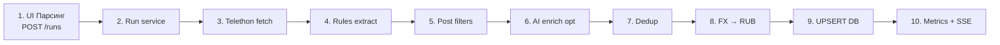

# Архитектура по логике

Бизнес-потоки: основной parse pipeline и боковые сценарии.

## Parse pipeline (главный поток)

| Шаг | Модуль |
|-----|--------|
| Run | `backend.services.run_service` |
| Fetch | `parsers.telegram_telethon` / `parse_runner` |
| Rules | `extraction/*` |
| Filters | `filters.vacancy_filters` |
| AI | `ai.enricher` → OpenRouter (+ cache) |
| Dedup | `deduplication.deduplicator` |
| FX | `fx.vacancy_rub` |
| DB | `backend.db.repository` |
| SSE | `progress_bus` → RunPage |

## Боковые потоки

```mermaid
flowchart TB
  subgraph Import
    I1["Текст из UI"] --> I2["Rules ± AI"] --> I3["UPSERT manual"]
  end

  subgraph HH["HH sync admin"]
    H1["Search listings"] --> H2["Dedup + detail"] --> H3["Mapper → vacancies"]
  end

  subgraph Match
    M1["POST match"] --> M2["кэш? → 200"]
    M1 --> M3["llm_jobs 202"]
    M3 --> M4["worker pool"]
    M4 --> M5["OpenRouter"]
    M5 --> M6["vacancy_matches"]
    M3 --> M7["GET /llm-jobs poll"]
  end

  subgraph Letter["Cover letter"]
    L1["POST letter"] --> L2["кэш? / llm_jobs"]
    L2 --> L3["worker → OpenRouter"]
    L3 --> L4["cover_letters"]
  end

  subgraph Analytics
    A1["Фильтры списка"] --> A2["SQL-агрегаты"] --> A3["salaries / sources / companies"]
  end
```

### Auth и данные

- **JWT** — login/register; API Bearer, SSE через `access_token`
- **Per-user** — resumes, saved_filters, matches, cover_letters, llm_jobs
- **Shared** — vacancies, parse_runs, analytics, FX, AI cache
- **Interactive LLM** — фоновые джобы in-process (`ai.interactive_concurrency`); сессия БД не держится на время вызова OpenRouter; несколько реплик backend потребуют внешней очереди
