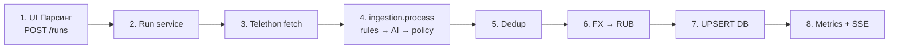

# Архитектура по логике

Бизнес-потоки: основной parse pipeline и боковые сценарии.

## Parse pipeline (главный поток)

| Шаг | Модуль |
|-----|--------|
| Run | `backend.services.run_service` |
| Fetch | `parsers.telegram_telethon` / `parse_runner` |
| Ingest | `jobdesk.ingestion` (`rules` + `process` + `IngestPolicy`) |
| Rules | `extraction/*` (через `ingestion.rules`) |
| Filters | `filters.vacancy_filters` (policy Telegram) |
| AI | `ai.enricher` → OpenRouter (+ cache port) |
| Dedup | `deduplication.deduplicator` |
| FX | `fx.vacancy_rub` |
| DB | `backend.db.vacancy_repository` (facade: `repository`) |
| SSE | durable `parse_runs.progress` + Redis pub/sub → RunPage |

### Shared ingestion и AI cache (ports)

- **Ingestion** — общий путь Telegram / manual import: `RawPost` → rules → optional AI → policy gates. HH sync остаётся на `hh/mapper` + `hh/dedup`.
- **Core ports** — `backend.core_ports.register_core_ports()` при старте каждого процесса с LLM (FastAPI lifespan, `parse-worker`, `llm-worker`) регистрирует Postgres-кэш extraction (`AIExtractionCacheBackend` → `DbAIExtractionCache`) и общий лимит запросов к LLM (`GlobalRateGate` → Redis), без импорта `backend` из core. Без кэша `AIEnrichmentService` не создаётся, и разбор молча уходит в правила.
- **Repositories** — bounded contexts: `parse_run_repository`, `vacancy_repository`, `user_content_repository`, `llm_job_repository`; `backend.db.repository` — совместимый re-export.

## Боковые потоки

```mermaid
flowchart TB
  subgraph Import
    I1["POST /vacancies/import"] --> I2["без LLM: ingestion MANUAL → 200"] --> I3["UPSERT manual"]
    I1 --> I4["с LLM: llm_jobs kind=import → 202"] --> I5["llm-worker: ingestion MANUAL + LLM"] --> I3
  end

  subgraph HH["HH sync admin"]
    H0["POST /hh/sync"] --> HQ["hh_sync_jobs 202"]
    HQ --> HR["Redis RQ hh"] --> HW["hh-worker"]
    HW --> H1["Search listings"] --> H2["Dedup + detail"] --> H3["Mapper → vacancies"]
    HQ --> HS["SSE / poll GET"]
  end

  subgraph Match
    M1["POST match"] --> M2["кэш? → 200"]
    M1 --> M3["llm_jobs 202"]
    M3 --> M4["Redis RQ"]
    M4 --> M5["llm-worker"]
    M5 --> M6["OpenRouter"]
    M6 --> M7["vacancy_matches"]
    M3 --> M8["SSE / poll GET"]
  end

  subgraph Letter["Cover letter"]
    L1["POST letter"] --> L2["кэш? / llm_jobs + RQ"]
    L2 --> L3["llm-worker → OpenRouter"]
    L3 --> L4["cover_letters"]
  end

  subgraph Analytics
    A1["Фильтры списка<br/>vacancy_filters"] --> A2["SQL-агрегаты"] --> A3["salaries / sources / companies"]
    A1 --> A4["Поиск q: сохранённый FTS<br/>ранжирование первых 1000"]
  end
```

### Auth и данные

- **JWT** — login/register; API Bearer + refresh-сессия в httpOnly cookie, SSE через одноразовый `?ticket=`
- **Per-user** — resumes, saved_filters, matches, cover_letters, llm_jobs
- **Shared** (чтение — любой залогиненный, мутации — админ) — vacancies, analytics, FX, AI cache
- **Admin-only** — parse_runs (`/runs/*`), ручной импорт, HH sync
- **Квота LLM** — `LLM_USER_DAILY_CALLS` вызовов в сутки на пользователя (админ — без лимита). Списывается при постановке джобы: исчерпанная квота отклоняется сразу, а не в воркере. Если модель так и не ответила, вызов возвращается в квоту.
- **Актуальность результатов** — сохранённые матч и письмо становятся `stale`, если сменилась запрошенная модель или версия промпта (`backend/services/llm_result_freshness.py`), и пересчитываются при следующем запросе без `force`.

### Жизненный цикл джоб

Parse runs, `llm_jobs` и `hh_sync_jobs` устроены одинаково: статус в Postgres, Redis — только транспорт.

- claim с lease и heartbeat → `running`; истёкший lease или `queued` без живой RQ-джобы поднимает recover-цикл, после `*_MAX_ATTEMPTS` — `failed` / `error`.
- **Отмена** — флаг `cancel_requested` в БД (`POST /runs/{id}/cancel`, `/llm-jobs/{id}/cancel`, `/hh/sync-jobs/{id}/cancel`). `queued` сразу становится `cancelled`; `running` проверяет флаг сам (прогон — поток-поллер, импорт — перед каждым текстом, HH — перед страницей и группой деталей, матч/письмо — после ответа модели, результат отбрасывается). Зависшую джобу с флагом recover закрывает `cancelled`.
- **Interactive LLM** — Task Queue (RQ) + Competing Consumers (`llm-worker`); Postgres = статус, Redis = очередь + pub/sub для SSE. Fallback `LLM_JOB_BACKEND=inprocess` для тестов. Scale: `--scale llm-worker=N`. `ai.requests_per_minute` общий для всех процессов (окно в Redis, `backend/services/llm_rate_gate.py`).
