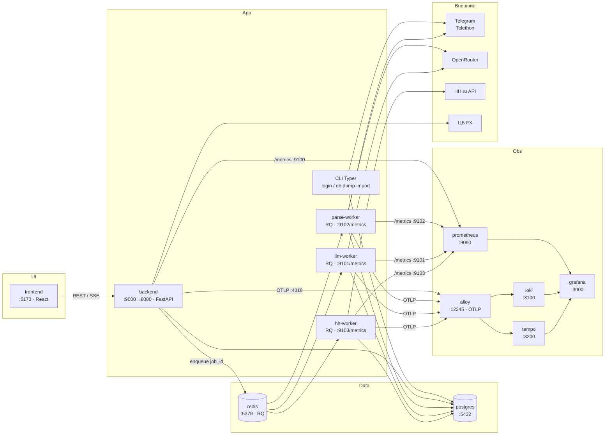

# Архитектура по сервисам

Runtime-карта: Docker Compose, внешние API, observability.

| Сервис | Порт | Роль |
|--------|------|------|
| frontend | 5173 | Web UI |
| backend | 9000→8000; 9100 (только Docker-сеть) | API, JWT, постановка джоб в очереди, курсы ЦБ; `/metrics` — на :9100 |
| parse-worker | 9102 (только Docker-сеть) | RQ `SimpleWorker`: прогоны парсинга (Telethon, LLM-разбор), очередь `parse`, concurrency=1 |
| llm-worker | 9101 (только Docker-сеть) | RQ `SimpleWorker`: мэтч/письма/ручной импорт с LLM; `/metrics` без DB COUNT-collector, с `db_pool_*` |
| hh-worker | 9103 (только Docker-сеть) | RQ `SimpleWorker`: фоновый HH sync (очередь `hh`) |
| redis | 6379 | Очереди RQ `llm` / `parse` / `hh` (AOF на томе `redis_data`) + pub/sub статуса SSE |
| postgres | 5432 | Вакансии, runs, users, FX, cache, `llm_jobs` |
| prometheus | 9090 | Scrape backend + воркеры (`dns_sd`) |
| grafana | 3000 | Дашборды / Explore (в т.ч. **DB pool**, **LLM jobs / queue**) |
| alloy | 12345 | Логи Docker + OTLP → Loki/Tempo |
| loki | 3100 | Логи |
| tempo | 3200 | Трассы |

Параллелизм LLM: `docker compose up --scale llm-worker=N`. Локально без Redis: `LLM_JOB_BACKEND=inprocess`.
