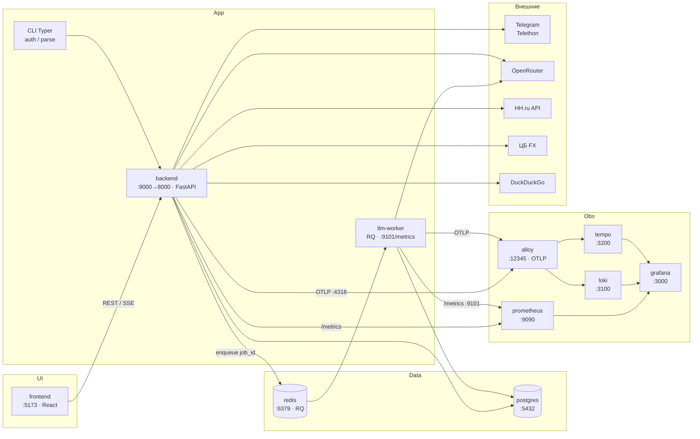

# Архитектура по сервисам

Runtime-карта: Docker Compose, внешние API, observability.

| Сервис | Порт | Роль |
|--------|------|------|
| frontend | 5173 | Web UI |
| backend | 9000→8000 | API, парсинг, JWT, `/metrics`, enqueue LLM jobs |
| llm-worker | 9101 (только Docker-сеть) | RQ worker: мэтч/письма; `/metrics` для Prometheus |
| redis | 6379 | Очередь RQ `llm` + pub/sub статуса SSE |
| postgres | 5432 | Вакансии, runs, users, FX, cache, `llm_jobs` |
| prometheus | 9090 | Scrape backend + llm-worker |
| grafana | 3000 | Дашборды / Explore (в т.ч. **LLM jobs / queue**) |
| alloy | 12345 | Логи Docker + OTLP → Loki/Tempo |
| loki | 3100 | Логи |
| tempo | 3200 | Трассы |

Параллелизм LLM: `docker compose up --scale llm-worker=N`. Локально без Redis: `LLM_JOB_BACKEND=inprocess`.
