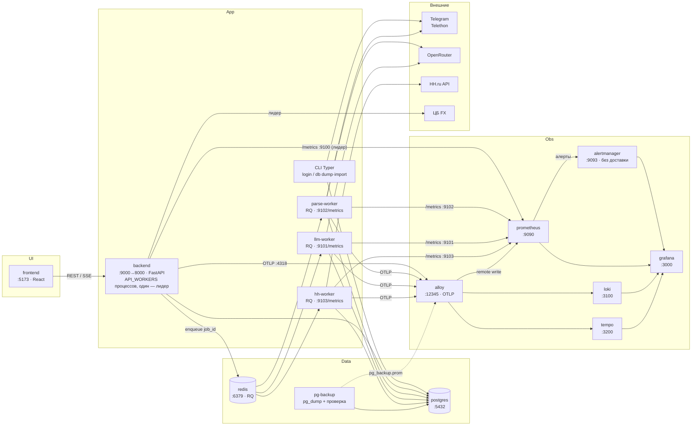

# Архитектура по сервисам

Runtime-карта: Docker Compose, внешние API, observability.

| Сервис | Порт | Роль |
|--------|------|------|
| frontend | 5173 | Web UI |
| backend | 9000→8000; 9100 (только Docker-сеть) | API, JWT, постановка джоб в очереди; `API_WORKERS` процессов (по умолчанию 4). Курсы ЦБ, плановая очистка и `/metrics` на :9100 — только у лидера |
| parse-worker | 9102 (только Docker-сеть) | RQ `SimpleWorker`: прогоны парсинга (Telethon, LLM-разбор), очередь `parse`, concurrency=1 |
| llm-worker | 9101 (только Docker-сеть) | RQ `SimpleWorker`: мэтч/письма/ручной импорт с LLM; `/metrics` без DB COUNT-collector, с `db_pool_*` |
| hh-worker | 9103 (только Docker-сеть) | RQ `SimpleWorker`: фоновый HH sync (очередь `hh`) |
| redis | 6379 | Очереди RQ `llm` / `parse` / `hh` (AOF на томе `redis_data`) + pub/sub статуса SSE |
| postgres | 5432 | Вакансии, runs, users, FX, cache, `llm_jobs` |
| pg-backup | — | `pg_dump` по расписанию с проверкой восстановления; состояние — файл `pg_backup.prom` в каталоге дампов |
| prometheus | 9090 | Scrape backend + воркеры (`dns_sd`); правила алертов (`observability/alerts/`); remote-write receiver для метрик k6 (`scripts/loadtest`) и бэкапа (Alloy) |
| alertmanager | 9093 | Сработавшие алерты Prometheus; доставки наружу нет — UI и Grafana → Alerting |
| grafana | 3000 | Дашборды / Explore (в т.ч. **DB pool**, **LLM jobs / queue**), Alerting |
| alloy | 12345 | Логи Docker + OTLP → Loki/Tempo; `pg_backup.prom` → Prometheus |
| loki | 3100 | Логи |
| tempo | 3200 | Трассы |

Параллелизм LLM: `docker compose up --scale llm-worker=N`. Локально без Redis: `LLM_JOB_BACKEND=inprocess`.

## Процессы API

- **`API_WORKERS`** — число процессов uvicorn в контейнере backend (GIL держит процесс на ~1 ядре).
  Пул соединений с Postgres делится между ними. Нескольким процессам нужны Redis (`rq`) и `JWT_SECRET`;
  локальный `uvicorn --reload` — всегда один процесс.
- **Лидер** (`backend/leader.py`) — процесс, удерживающий `pg_try_advisory_lock` на отдельном соединении.
  Только он синхронизирует курсы ЦБ при старте, раз в час чистит БД и поднимает сервер `/metrics`
  (сумма метрик всех процессов через `PROMETHEUS_MULTIPROC_DIR`). Если лидер упал, Postgres снимает
  lock вместе с сессией, и роль за ≤30 с берёт другой процесс.
- **Защита от перегрузки** (`backend/overload.py`) — у каждого процесса столько мест обработки, сколько
  соединений в пуле. Запрос, не получивший место за `API_QUEUE_TIMEOUT_SECONDS`, получает быстрый
  503 `OVERLOADED` (`Retry-After: 1`), а не висит до тайм-аута пула. `/health` идёт без очереди.
