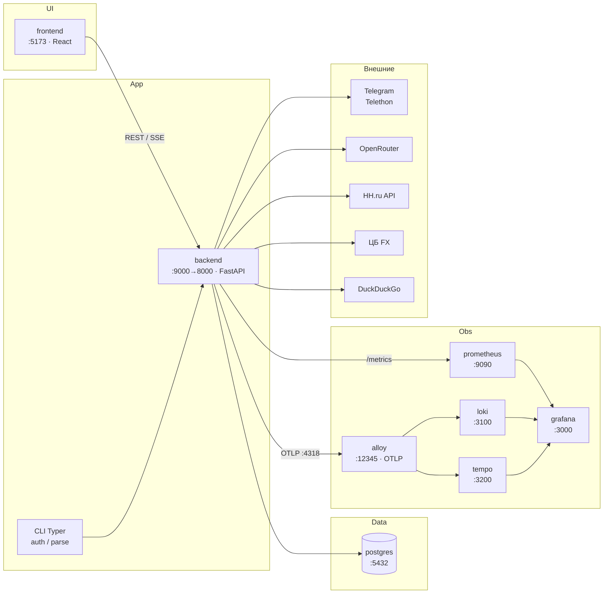

# Архитектура по сервисам

Runtime-карта: Docker Compose, внешние API, observability.

| Сервис | Порт | Роль |
|--------|------|------|
| frontend | 5173 | Web UI |
| backend | 9000→8000 | API, парсинг, JWT, `/metrics` |
| postgres | 5432 | Вакансии, runs, users, FX, cache |
| prometheus | 9090 | Scrape метрик |
| grafana | 3000 | Дашборды / Explore |
| alloy | 12345 | Логи Docker + OTLP → Loki/Tempo |
| loki | 3100 | Логи |
| tempo | 3200 | Трассы |
